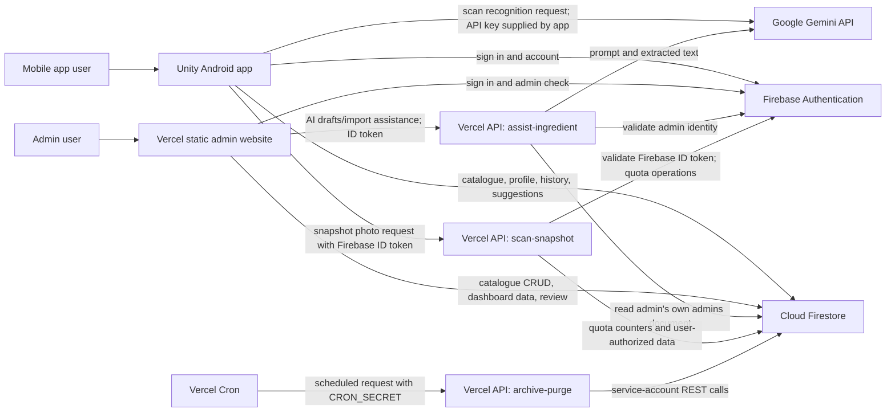

# 01. System overview and architecture

GlowUp consists of a Unity mobile application, a static admin website, Firebase services, and Vercel serverless functions. The mobile app uses Firestore for catalogue and account data, Firebase Authentication for account operations, and a Gemini API client for AI-assisted scan recognition. Admin pages use Firebase Authentication and Firestore directly; selected admin-only or user-triggered tasks call Vercel functions. The project configuration points these clients at Firebase project `glowup-admin-portal` (`GlowUp/Assets/_Project/Scripts/Data/FirebaseBootstrap.cs`, `GlowUp-Admin_AI_Testing/_Database/firebase-console.js`, `GlowUp-Admin_AI_Testing/api/assist-ingredient.js`).

The diagram distinguishes direct client-to-Firestore access from serverless calls. The website's AI endpoint checks the Firebase identity and admin record before using Gemini; the snapshot endpoint accepts a signed-in Firebase user and enforces quotas; the daily archive purge uses a Vercel cron and a service account. These mechanisms are implemented in `GlowUp-Admin_AI_Testing/api/assist-ingredient.js`, `api/scan-snapshot.js`, `api/archive-purge.js`, and `vercel.json`. A named Firebase Storage integration is not found: the schema says snapshot images are held in Firestore documents and Firebase Storage is not used (`FIRESTORE_SCHEMA.md`).

## Service boundaries

| Component | Responsibility and evidence |
|---|---|
| Unity mobile client | Screens, camera/OCR/barcode flow, local product matching and analysis, Firestore repositories, local cache and queued writes (`GlowUp/Assets/_Project/Scripts/Scan/SmartScanFlowController.cs`, `Data/*Repository.cs`, `Data/OfflineCache.cs`, `Data/SyncQueue.cs`). |
| Admin website | Static HTML/JavaScript deployed through Vercel; page scripts access Firebase Auth and Firestore (`GlowUp-Admin_AI_Testing/_Index/index.html`, `_Database/firebase-console.js`, `_Shared/adminCommon.js`). |
| Firestore | Shared catalogue, user-owned profile/history, anonymous scan activity, suggestions, configuration and moderation records (`GlowUp-Admin_AI_Testing/FIRESTORE_SCHEMA.md`, `firestore.rules`). |
| Firebase Authentication | Mobile email/password/social account flows and admin website email/password login. The web auth import and mobile Firebase Auth calls are in the sources cited in Chapters 02 and 04. |
| Gemini | Mobile scan client directly calls the configured Google Generative Language endpoint; Vercel functions use Gemini for admin assistance and snapshot reading (`GlowUp/Assets/_Project/Scripts/Scanning/Geminiapiclient.cs`, `GlowUp-Admin_AI_Testing/api/assist-ingredient.js`, `api/scan-snapshot.js`). |
| Vercel | Static website hosting, three API functions and a configured daily cron for archive purge (`GlowUp-Admin_AI_Testing/vercel.json`). |

**NOT FOUND IN CODE:** a separate custom backend application, a scheduled mobile-client job, or a separately configured payment service is not established by these cited sources.
