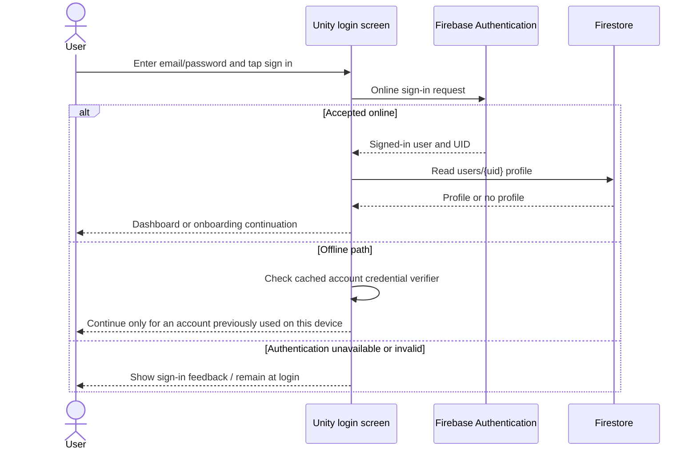
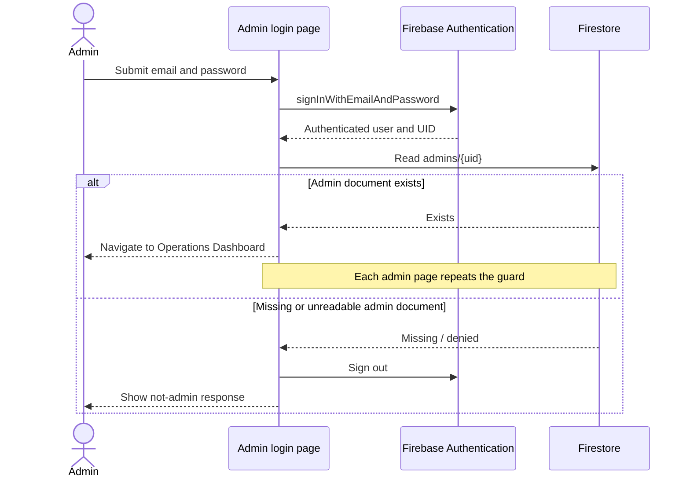

# 04. Authentication and authorization

## Mobile users

The login controller uses Firebase Authentication for online email/password sign-in, password reset and supported social sign-in flows. It can restore a current Firebase session; it also has an offline credential path using a locally stored verifier. The source documents Argon2id for that offline check. The mobile client reads user profile data under `users/{uid}` and writes that user's scans under `users/{uid}/scans/{scanId}`. Rules use `request.auth.uid` to protect those records (`GlowUp/Assets/_Project/Scripts/Auth/LoginFlowController.cs`, `Auth/SocialSignIn.cs`, `Auth/Argon2idHasher.cs`, `Data/UserProfileRepository.cs`, `Data/ScanHistoryRepository.cs`, `GlowUp-Admin_AI_Testing/firestore.rules`).

This sequence summarizes the online and offline branches described in `LoginFlowController.cs` and `UserProfileRepository.cs`; it is not a guarantee of successful authentication. Firestore rules separately enforce owner access. Google social sign-in and other provider availability depend on setup described by the controller; only controls wired in the scene are usable.

## Admin website

The web login page signs in with Firebase email/password. It checks for a document whose ID equals the user's UID in `admins`. The shared `requireAdmin()` guard runs for admin pages; Firestore rules independently check the admin record (or an admin custom claim). In the source, the web gate `REQUIRE_ADMIN_RECORD` is `true` (`GlowUp-Admin_AI_Testing/_Index/indexApp.js`, `_Shared/adminCommon.js`, `firestore.rules`).

The website login guard is a client-side navigation/access check, not the only authorization mechanism. Firestore rules protect writes and reads, and API routes re-check the token/admin status where needed. Admin IDs are described in the schema as manually managed in the Firebase console (`FIRESTORE_SCHEMA.md`, `firestore.rules`, `api/assist-ingredient.js`).

## Where roles and access are checked

| Surface | Check in code |
|---|---|
| Mobile login/session | Firebase Authentication user state; offline login uses device-held profile/credential state (`LoginFlowController.cs`, `UserProfileRepository.cs`). |
| Mobile Firestore access | Firestore rules check signed-in status and UID ownership for `users/{uid}` and child scan history (`firestore.rules`). |
| Admin page navigation | `requireAdmin()` checks auth state and reads `admins/{uid}` before revealing the page (`_Shared/adminCommon.js`). |
| Firestore admin access | `isAdmin()` in rules recognizes an admin claim or matching `admins/{uid}` record; catalogue writes are guarded by admin conditions (`firestore.rules`). |
| Vercel AI assistance | Checks Firebase identity and then the admin's own `admins` record before returning assistance (`api/assist-ingredient.js`). |
| Vercel snapshot | Verifies a signed-in Firebase identity; per-user and global quota rules restrict spending (`api/scan-snapshot.js`, `firestore.rules`). |
| Archive purge | Requires configured cron secret and service-account credentials; function has a narrow `archive` collection path and dry-run default (`api/archive-purge.js`). |

## Gaps and limits visible in source

- The offline login path is a local-device convenience and does not establish a fresh server-authenticated session while offline. See `LoginFlowController.cs` and `UserProfileRepository.cs`.
- **NOT FOUND IN CODE:** server-side admin role enforcement for direct mobile catalogue reads is needed beyond the Firestore rules; the client is not an admin role authority.
- A client-side admin guard can be bypassed as a UI control, but Firestore rules/API checks remain the actual data boundary. **RECOMMENDED:** keep rules and endpoint checks authoritative and test every collection path.
- **NOT FOUND IN CODE:** a separately evidenced multi-factor authentication requirement or organization-wide role hierarchy.
