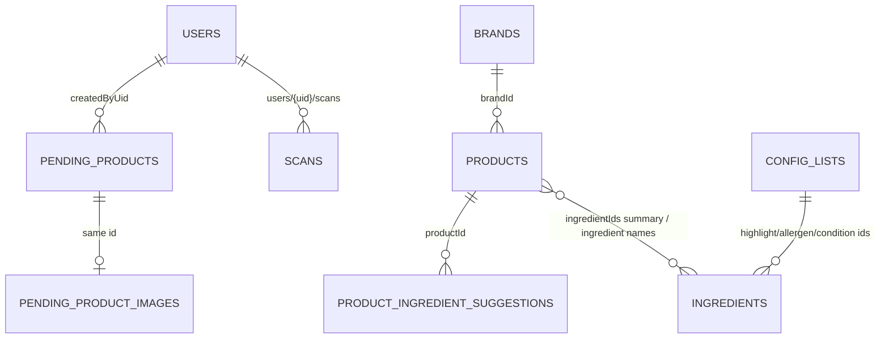

# 05. Database: type, structure and communication

## Database type and client communication

GlowUp uses Cloud Firestore, a document database in the Firebase project shared by mobile and admin clients (`GlowUp-Admin_AI_Testing/FIRESTORE_SCHEMA.md`, `firestore.rules`). Unity uses Firebase Firestore repositories. The website imports the Firebase JavaScript Firestore SDK and calls it from page modules. No custom catalogue REST API is found; the two clients read and write Firestore directly, subject to security rules.

On mobile, `FirebaseBootstrap.cs` enables Firestore persistence and sets a 100 MiB cache. App repositories keep JSON copies under `Application.persistentDataPath/GlowUpCache` through `OfflineCache.cs`. Writes can be queued and replayed by `SyncQueue.cs`. Brands, products and ingredients are refreshed incrementally through `CatalogSync.cs`. On the website, `adminStore.js` keeps page data in browser memory and uses Firestore updates; indexed database configuration files are **NOT FOUND IN CODE** (`GlowUp-Admin_AI_Testing/firebase.json` configures rules and emulator, not composite indexes).

## Collections and document fields

The schema below combines the shared contract in `GlowUp-Admin_AI_Testing/FIRESTORE_SCHEMA.md` with mobile model definitions in `GlowUp/Assets/_Project/Scripts/Data/DataModels.cs`. Optional or evolving website-only fields are retained in the schema source; the mobile model may not deserialize every website field.

| Collection/path | Fields documented in code/schema |
|---|---|
| `brands/{id}` | `name`, `category`, `aliases`, `market`, `status`, `scans`, `source`, `reviewed`, `logoUrl`, `imageUrl`, confirmed `website`, `websiteConfirmedBy`, `websiteConfirmedAt`, `websiteSuggested`, `aiAssistSources`, `aiAssistModel`, `createdAt`, `updatedAt`; website management fields `folder`, `binned`, `binnedAt`, `statusBeforeBin`, `binnedReason`. Mobile `BrandData` includes `id`, `name`, `category`, `market`, `status`, `website`, `scans`, `binned`, `aliases`. |
| `products/{id}` | `name`, `brandId`, `brandName`, `cosmeticType`, `aliases`, `description`, `ingredients`, `shades`, `shadeCodes`, `sources`, `imageUrl`, `ingredientIds`, `ingredientCount`, `ingredientNotes` (`name`, `id`, `caution`, `percent`), `tags`, `minAge`, `status`, `scans`, `source`, `reviewed`, `aiAssistModel`, `createdAt`, `updatedAt`, `barcode`, FDA fields. Website fields also include `folder`, `binned`, `binnedAt`, `statusBeforeBin`, `binnedWith`, `binnedReason`. Mobile `ProductData` fields include `id`, name/brand/type/description/status, `officialIngredientSource`, `shadeColor`, `minAge`, `scans`, `source`, `barcode`, `reviewed`, ingredient-category lists, `shades`, `shadeCodes`, `sources`, `fdaNumber`, `binned`, `aliases`. |
| `ingredients/{id}` | `name`, `techName`, `description`, `aliases`, `riskLevel`, `cautionNote`, `commonUses`, `minAge`, `keyActive`, `umbrella`, `chemicalDescription`, `highlights`, `allergenTags`, `avoidForSkinTypes`, `goodForSkinTypes`, `avoidForConditions`, `goodForConditions`; provenance fields `source`, `reviewed`, `reviewedAt`, `reviewedBy`, `addedBy`, `addedAtUnix`, `sources`, `fdaUnii`, `webSearched`, `model`; website fields `folder`, `binned`, `binnedAt`, `binnedReason`. Mobile `IngredientData` also has `generic`. |
| `productIngredientSuggestions/{id}` | `productId`, `productName`, `brandName`, `ingredients`, `sources`, `source`, `status`, `reviewed`, `addedBy`, `addedAtUnix`. It is a proposal for a product with no ingredient list, not the product record itself. |
| `config/lists` | `version`, `updatedAt`, `allergens`, `conditions`, `highlights`; list entries have `id`, `label`, `keywords`, `retired`. |
| `pending_products/{id}` | `name`, `brandName`, `cosmeticType`, `shadeHex`, `variant`, `size`, `sourceUrls`, `ingredients`, `hasImage`, `isApproved`, `createdByUid`, `status`, `source`, `key`, `confidence`, `model`, `createdAtUnix`. Snapshot data remains separated from curated products. |
| `pending_product_images/{id}` | `jpegBase64`, `bytes`, `createdByUid`, `createdAtUnix`. Schema says admins can read; mobile clients do not download these images. |
| `snapshot_quota/{uid}_{day}` and `snapshot_quota/all_{day}` | `count`, `lastAt` (per-user document), `uid`, `day`; quota document IDs are bound to account/day by rules. |
| `users/{uid}` | Profile fields in `UserProfileData`: `uid`, names, `username`, `email`, `birthday`, `age`, `skinType`, `skinTone`, `skinConditions`, `knownAllergens`, `termsAccepted`, `theme`, `createdAtUnix`. |
| `users/{uid}/scans/{scanId}` | Scan history represented by `ScanRecord`: product/brand/type identifiers, date, ingredients and findings, result/compatibility, shade and barcode data, FDA response, ingredient-list source/provenance, recommendation metadata, pending/deleted/synced flags. `displayName` is documented as local only. See `DataModels.cs` for the full field list. |
| `scanActivity/{id}` | Anonymous dashboard summary: `productName`, `brandId`, `brandName`, `cosmeticType`, `status`, `source`, `scannedAtUnix`, ingredient/harmful/caution counts, `allergenFlagged`, `flaggedIngredients`. The model intentionally excludes user name/email/UID. |
| `allergenSuggestions/{id}`, `conditionSuggestions/{id}` | User-submitted suggestion fields include `uid`, `status`, `text`; rules require pending status and limit text length. |
| `admins/{uid}` | Admin membership document; the schema describes hand-managed records. The record's business fields are **NOT FOUND IN CODE**; its document ID is the UID. |
| `archive/{collection}__{id}` | `type`, `sourceCollection`, `sourceId`, `name`, `data` (original document), `deleted_at`, `expires_at`, `deleted_by`, `deleted_by_email`, optional `archivedWith`. |
| `archive_purge_log/{runId}` | `ranAt`, `mode`, `found`, `deleted`, `capped`, `ids`, `errors`. |

Collection list and website-side optional fields are in `FIRESTORE_SCHEMA.md`; user/profile and scan-record fields are in `DataModels.cs`; access rules and accepted record shapes are in `firestore.rules`. **NOT FOUND IN CODE:** other collections should not be inferred from Firebase console contents not included here.

## Product, brand and ingredient relationships

This diagram shows the fields and nested paths documented by the project, not relational constraints enforced by Firestore. `brandId` links a product to a brand; a product keeps ingredient names and a light list of matched ingredient IDs rather than a SQL join. Ingredient safety is calculated against current ingredient records and the user's profile. Suggestions do not overwrite product data until accepted. Sources: `FIRESTORE_SCHEMA.md`, `DataModels.cs`, `firestore.rules`.

## Read/write and caching behavior

- Website catalogue data and admin activity are read from Firestore; admin pages perform direct client SDK operations (`_Shared/adminStore.js`, `_Admin_Dashboard/adminDashboard.js`).
- The app loads catalogue records, filters them to active, unbinned makeup, and retains offline copies (`BrandRepository.cs`, `ProductRepository.cs`, `IngredientRepository.cs`).
- Profile and scan history are user-specific. Scan records are stored locally for immediate recent-history UI and queued to `users/{uid}/scans` when signed in; recent scan rename/removal details are partly local (`ScanHistoryRepository.cs`).
- Firestore indexes: **NOT FOUND IN CODE**. `firebase.json` names the rules file and emulator configuration; there is no declared `firestore.indexes.json` in the inspected project map.
- A Firestore REST composite query may still require an index at runtime; **NOT FOUND IN CODE** whether a deployed project has additional console-created indexes.
