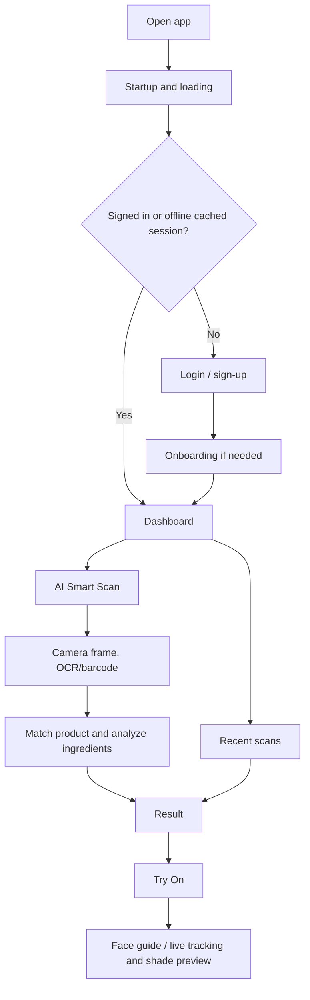
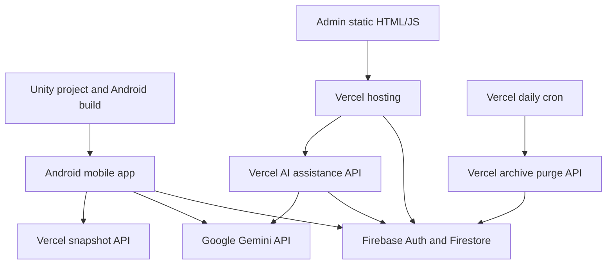

# 11. Flows and data flow

Diagrams represent paths visible in the checked-in source. Optional branches are marked as optional; they do not imply that every deployment or device enables them.

## 1. Mobile user flow: open, scan, result, try-on



The app's login controller routes to onboarding or dashboard based on profile/session state; the dashboard shortcuts open scan, Recent and Try-On. Scan result can also be opened from Recent, and product results can route to AR Try-On. Sources: `GlowUp/Assets/_Project/Scripts/Auth/LoginFlowController.cs`, `Dashboard/DashboardFlowController.cs`, `Common/BottomActionBar.cs`, `Scan/SmartScanFlowController.cs`, `Result/ScanResultFlowController.cs`, `Recent/RecentScansFlowController.cs`, `AR/ArTryOnFlowController.cs`.

## 2. Admin website flow: login, import, review and organization

```mermaid
flowchart TD
  A[Open admin login] --> B[Firebase email/password]
  B --> C{admins/{uid} exists?}
  C -->|No| D[Sign out and show denied]
  C -->|Yes| E[Operations Dashboard]
  E --> F[Open Inventory]
  F --> G[Choose/drop import file]
  G --> H[Parse/extract and stage Pending records]
  H --> I[Review snapshots or pending inventory]
  I --> J{Approve / edit / reject}
  J -->|Approve| K[Save approved records to catalogue]
  J -->|Reject| L[Remove pending record]
  F --> M[Edit brand/product records]
  F --> N[Move to Recycle Bin]
  N --> O{Restore or Archive?}
  O -->|Restore| F
  O -->|Archive| P[Archive for 30 days]
  P --> Q[Restore to bin or delete now]
```

The admin portal checks a Firebase-authenticated UID against `admins`; inventory imports are described as pending until reviewed. Recycle Bin and Archive expose the listed restoration/deletion actions. Sources: `_Index/indexApp.js`, `_Shared/adminCommon.js`, `_Admin_Brand_Inventory/adminBrandInventory.html`, `_Admin_Brand_Inventory/adminBrandInventory.js`, `_Admin_Recycle_Bin/adminRecycleBin.js`, `_Admin_Archive/adminArchive.js`, `FIRESTORE_SCHEMA.md`.

## 3. One scan: camera through result

```mermaid
sequenceDiagram
  actor User
  participant App as Unity Smart Scan
  participant OCR as On-device OCR/barcode
  participant Catalog as Local cache / Firestore
  participant AI as Gemini (optional)
  participant Hist as Firestore scan paths
  User->>App: Start scan
  App->>OCR: Read camera frames
  OCR-->>App: Text lines / barcode
  App->>App: Filter frame quality and rank candidate matches
  App->>Catalog: Check cached brands/products first
  alt Candidate is recognized
    Catalog-->>App: Product, ingredients, shades
  else Unclear or not found
    App-->>User: Shortlist / typed entry / retry
    opt AI recognition configured
      App->>AI: Scan request
      AI-->>App: Candidate recognition response
    end
  end
  App->>App: Analyze ingredients against profile
  App->>Hist: Save user scan; enqueue writes
  App->>Hist: Create anonymous scanActivity summary
  App-->>User: Result screen
```

The fast scan path uses camera frames, OCR, local matching and analysis; barcode and AI recognition are additional identification options. `ScanHistoryRepository` stores the local record and queues a user-owned scan write; the scan publisher writes a separate anonymous dashboard summary. Exact ordering and every candidate-ranker branch are **PARTIALLY TRACED** at diagram level. Sources: `Scan/SmartScanFlowController.cs`, `Scan/FrameQuality.cs`, `Scan/ProductMatcher.cs`, `Scan/ScanAnalysisPipeline.cs`, `Scanning/Geminiapiclient.cs`, `Data/ScanHistoryRepository.cs`, `Data/ScannedProductPublisher.cs`, `firestore.rules`.

## 4. Admin import to Firestore to mobile app

```mermaid
flowchart LR
  A[Admin selects import file] --> B[Browser extracts text]
  B --> C[Optional Vercel admin AI draft]
  C --> D[Admin reviews fields]
  D --> E[Website writes Pending records to Firestore]
  E --> F[Admin approves]
  F --> G[Website updates status/review fields]
  G --> H[Mobile CatalogSync downloads changed documents]
  H --> I[Offline cache and product/ingredient indexes]
  I --> J[Mobile scan, recommendations and AR use active records]
```



The website's schema documents browser-side extraction and pending import behavior, while mobile repositories refresh changed Firestore records and cache them. Products/brands become usable only when active and otherwise eligible; ingredient data feeds analysis. Sources: `GlowUp-Admin_AI_Testing/FIRESTORE_SCHEMA.md`, `_Shared/importFormat.js`, `api/assist-ingredient.js`, `_Shared/adminStore.js`, `GlowUp/Assets/_Project/Scripts/Data/CatalogSync.cs`, `ProductRepository.cs`, `IngredientRepository.cs`.

## 5. Deployment and external services



The codebase contains a Unity Android app, static website pages, Firebase client configuration, Vercel API routes and cron configuration. The diagram does not assert how Unity builds are distributed or how Vercel deploys are triggered: **NOT FOUND IN CODE** in the inspected project files. Sources: `GlowUp/ProjectSettings/ProjectVersion.txt`, `GlowUp/Packages/manifest.json`, `GlowUp-Admin_AI_Testing/vercel.json`, `_Database/firebase-console.js`, `api/*.js`, `FirebaseBootstrap.cs`, `Geminiapiclient.cs`.
