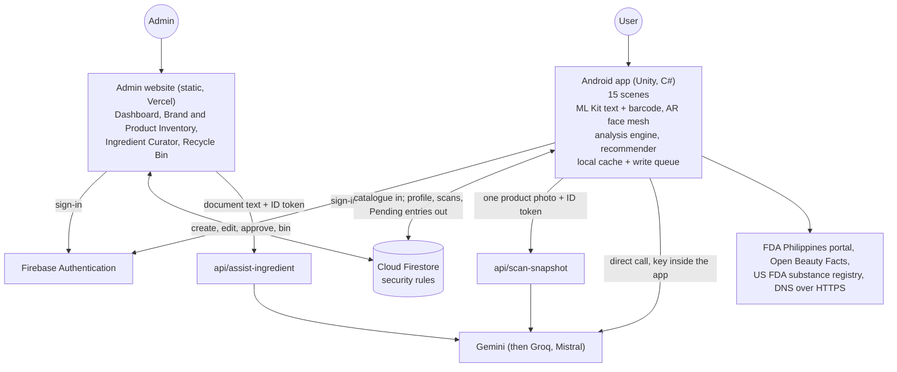
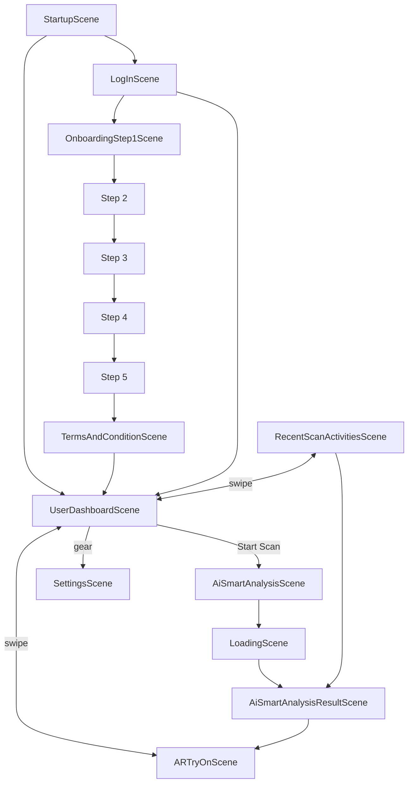
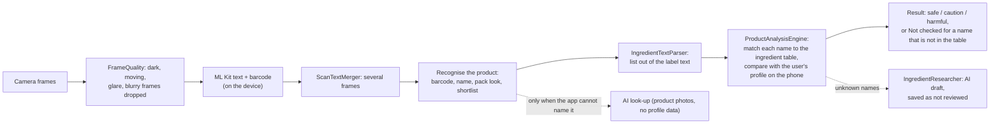

# GlowUp: the architecture as found in the code

Written on 28 October 2026 from the repository itself (manifests, project settings, source). Nothing here is copied from the thesis or from older
documents; where this file and another document disagree, the code is the tie-breaker and this file says which file to look at.
It is the baseline for every "does this already exist?" check in `docs/AGENT_REPORT.md`.

## 1. What the project is made of

| Part | What was found | Where it was found |
|---|---|---|
| Mobile app | Unity **2022.3.62f3**, C#, Universal Render Pipeline 14.0.12, uGUI + TextMeshPro 3.0.7, old Input Manager | `GlowUp/ProjectSettings/ProjectVersion.txt`, `Packages/manifest.json`, `ProjectSettings.asset` (`activeInputHandler: 0`) |
| App target | **Android only**: min SDK 23, ARMv7 + ARM64 (`AndroidTargetArchitectures: 3`), version 0.1.0 | `ProjectSettings.asset` |
| AR | AR Foundation + ARCore **5.2.2** (face mesh); a guided preview is the automatic fallback when ARCore is missing | `Packages/manifest.json`, `Scripts/AR/` |
| Text and barcode reading | Google ML Kit through our own Java plug-ins (`GlowUpTextReader.java`, `GlowUpBarcodeReader.java`, `GlowUpFrameReader.java`); a Tesseract build (`libtesseract.so`, `TesseractWrapper`) is also present | `Assets/Plugins/Android/`, `Scripts/Scan/OcrService.cs`, `MlKitTextReader.cs` |
| Other on-device reading | MediaPipe pack embedder (`GlowUpPackEmbedder.java`) and hand reader for finger signs (`GlowUpHandReader.java`) | `Assets/Plugins/Android/`, `Scripts/Scan/PackEmbedder.cs` |
| Database and sign-in | **Firebase**: Cloud Firestore + Authentication (e-mail/password, Google, Facebook when the Facebook SDK is present: `GLOWUP_FACEBOOK` define). Unity Firebase SDK 13.17.0 in the app, Firebase JS 10.12.0 on the website. Project `glowup-admin-portal` | `Assets/Firebase`, `GlowUp-Admin_AI_Testing/_Database/firebase-console.js`, `.firebaserc` |
| Offline | The app turns Firestore persistence on (100 MB cache) and keeps its own JSON copy and a write queue (`SyncQueue`); the website keeps its lists in the browser (`adminStore.js`) | `Scripts/Data/FirebaseBootstrap.cs`, `SyncQueue.cs`, `OfflineCache.cs`, `_Shared/adminStore.js` |
| Admin website | Plain static HTML + ES modules (no build step, no package manager), hosted on **Vercel** project `glowup-admin` | `GlowUp-Admin_AI_Testing/`, `vercel.json` |
| Server code | Two Vercel functions, Node: `api/assist-ingredient.js` (admins only; Gemini, then Groq, then Mistral; keys are Vercel environment variables) and `api/scan-snapshot.js` (signed-in app users; one product photo to Gemini, with daily limits kept in Firestore) | `GlowUp-Admin_AI_Testing/api/` |
| AI used by the phone | The app calls Gemini **directly**; the key is compiled into the app (`Scripts/Security/SecureProfileStore.cs`, a file Git ignores). See the risks in the report | `Scripts/Scan/AiResearchClient.cs`, `ProductAiAdvisor.cs` |
| Public data used | FDA Philippines verification portal (is a product notified?), Open Beauty Facts (second opinion on a list), the US FDA substance registry (UNII), DNS over HTTPS (does an e-mail domain have a mail server?) | `Scripts/Scan/PhFdaVerification.cs`, `OpenBeautyFacts.cs`, `FdaSubstanceRegistry.cs`, `Scripts/Auth/` |
| Tests | App: NUnit EditMode tests in `Assets/_Project/Editor/Tests` (Unity Test Framework 1.1.33). Website: `tests/*.test.mjs` run with `node`. Rules: `tests/rules` (Firestore emulator). Reader accuracy: `tools/ScannerEval` | see `README.md` |

There is **no server of our own** besides the two Vercel functions: the phone and the website talk to Firebase directly, so the security rules
(`GlowUp-Admin_AI_Testing/firestore.rules`) are the gatekeeper.

## 2. The system

## 3. The mobile app, as the scenes show it

The 15 scenes are generated by Editor builder scripts (`Assets/_Project/Editor/*Builder*.cs`, menu `GlowUp > Build Scene`).

What each part does (file level; read the file for the detail):

| Screen | What it does | Main code |
|---|---|---|
| Log in / sign-up | E-mail rule (known providers, or a domain with a mail server; throw-away domains refused), e-mail link confirmation, Google and Facebook sign-in, saved e-mails list | `Scripts/Auth/`, `OnboardingStep1FlowController.cs` |
| Onboarding 1 to 5 | Name, birthday (minimum age 13), skin type, skin tone, skin conditions, known allergens (a built-in list plus the editable `config/lists` families, or typed in), summary; then the terms and privacy policy tick box | `Scripts/Onboarding/`, `Legal/PrivacyPolicyAndTerms.txt` |
| Dashboard | Greeting, recommended products (make-up only, nothing flagged for the profile), shortcuts | `Scripts/Dashboard/`, `Scan/ProductRecommender.cs` |
| AI Smart Analysis (scan) | Hold-to-scan ring, barcode, text read with ML Kit, product recognition, ingredient list reading, optional typed entry | `Scripts/Scan/` |
| Result | Verdict per ingredient against the profile, FDA Philippines badge, source of the list, alternatives, AR Try-On shortcut | `Scripts/Result/`, `Scan/ProductAnalysisEngine.cs` |
| Recent scans | History, rename, delete with a sound, re-scan without duplicates | `Scripts/Recent/` |
| AR Try-On | Live face-mesh try-on (lips, cheeks, brows, face powders) or a guided preview; shade picker from the product's shades; shade code read from the pack picks the colour | `Scripts/AR/`, `Scan/ShadeCode.cs`, `Scan/ShadeAdvisor.cs` |
| Settings | Account (log out, **Delete My Account**), theme, sound, AR quality, frame-rate cap, notifications, finger signs, cache cleaner, support form | `Scripts/Settings/` |

### How a scan becomes a verdict

The user's profile is compared with a product **on the phone**. The privacy policy and `ScanAnalysisPipeline` state that name, e-mail, age, skin type,
skin tone, conditions and allergens are not sent to the AI (this was fixed on 12 October 2026; an earlier build sent them).

## 4. The admin website

| Page | Folder | What it does |
|---|---|---|
| Login | `_Index/` | Firebase sign-in; turns away accounts that have no document in `admins/` (`REQUIRE_ADMIN_RECORD = true`) |
| Dashboard | `_Admin_Dashboard/` | Counts and charts from `scanActivity`, `brands`, `products`, `ingredients`; reviews `allergenSuggestions` and `conditionSuggestions`. Numbers are read from Firestore (no hard-coded or sample values were found) |
| Brand and Product Inventory | `_Admin_Brand_Inventory/` | Brands and products: forms, shades and shade codes, import from files, FDA Philippines look-up, duplicates, clean-up, approve what the app added, pending photo snapshots |
| Ingredient Curator | `_Admin_Ingredient_Curator/` | Ingredient master list with simplified definitions; AI-found entries wait for review; Assist with AI; editable allergen / condition / highlight lists; list of ingredient names used by products that have no entry yet (most used first) |
| Recycle Bin | `_Admin_Recycle_Bin/` | Restore or delete forever |
| Shared code | `_Shared/` | Rules shared with the app (`glowupRules.js`), store, shell, layouts, import readers (`importFormat.js`, `ingredientBlock.js`, `adminDocumentReader.js`) |

## 5. Firestore: what is read and written

The full field list is `GlowUp-Admin_AI_Testing/FIRESTORE_SCHEMA.md`; the shape in short:

| Collection | Written by | Read by |
|---|---|---|
| `brands`, `products`, `ingredients` | website (admins). The app only creates `Pending` / `reviewed: false` entries (`scan_...`, `ai_...`) and adds 1 to `scans` | everybody |
| `config/lists` | website (admins) | everybody |
| `productIngredientSuggestions` | app (create), website | admins |
| `pending_products`, `pending_product_images` | app (create, own id), website (approve) | the sender (own entry) and admins |
| `snapshot_quota` | the `scan-snapshot` function with the user's own token | the same user |
| `scanActivity` | app (anonymous note: no user id) | admins |
| `allergenSuggestions`, `conditionSuggestions` | app | admins |
| `users/{uid}`, `users/{uid}/scans` | that user | that user only |
| `admins/{uid}` | by hand in the Firebase console | the account itself (rules and the login page) |

## 6. Findings that matter for the rest of the work

1. Most of what the data-integrity brief asks for **already exists** under other names (see `docs/DATA_MODEL.md`, the mapping table).
2. The phone calls Gemini with a key compiled into the app. Anyone who unpacks the APK can read it.
3. There is no remote on the Git repository, so there is no CI.
4. The thesis PDF is not in the repository (`docs/` holds an unrelated game design, and this project's own documentation, which are not the thesis).
